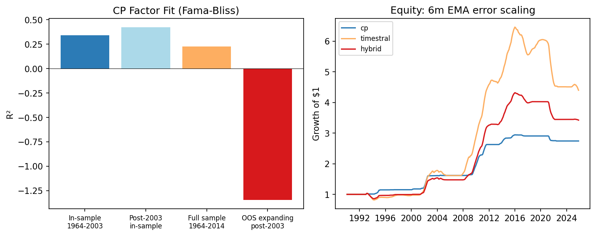
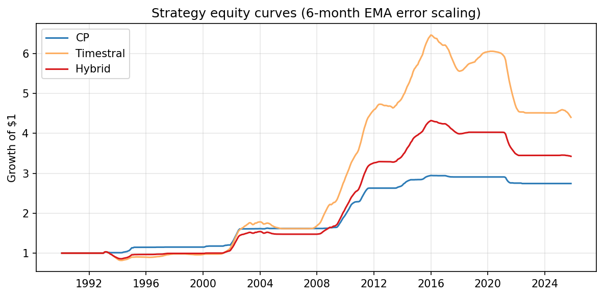

# Cochrane-Piazzesi vs Timestral

Replication of Cochrane and Piazzesi (2005) and comparison with a zero-shot time-series foundation model on U.S. Treasury excess returns.

## Data
Fama-Bliss monthly yields from WRDS (`crsp.fbyld`). **The file ends in December 2014.** All results are limited by that date.

## Methods
One-year holding-period excess returns on 2- to 5-year zero-coupon bonds are  
`rx(n) = n·y(n) – (n–1)·y(n–1 next year) – y(1)`.  
The Cochrane-Piazzesi factor is the fitted value from a regression of the average of these excess returns on the five one-year forward rates. The headline paper result is in-sample on 1964–2003. Out-of-sample forecasts re-estimate the regression using only data available at each date.

## In-sample replication (1964–2003)
- R² = 0.343 (paper range 0.35–0.44)
- Tent-shaped loadings on the forward rates

## Post-2003 and full sample
| Sample | R² | Notes |
|--------|----|-------|
| 2004–2014 (in-sample) | 0.425 | Different loadings |
| 1964–2014 | 0.228 | Diluted |
| Expanding-window OOS post-2003 | −1.345 | Does not beat historical mean |

## Strategy results
Only two rules produced a meaningful difference. Both cap the position at 0.75×.

### Main rule: 6-month exponential error scaling
Position is scaled down when recent absolute forecast errors are large.

| Forecast | Sharpe | Ann. return | Max DD | Sharpe @ 2 bp |
|----------|--------|-------------|--------|---------------|
| CP | 1.09 | 2.86% | −6.8% | 1.08 |
| Timestral (28M) | 1.00 | 4.24% | −31.9% | 1.00 |
| Hybrid | 1.04 | 3.50% | −20.7% | 1.04 |

### Alternative: dual moving-average entry/exit
Hold only when a 3-month EMA of the forecast is above its 12-month SMA.

| Forecast | Sharpe | Ann. return | Max DD | Time in market |
|----------|--------|-------------|--------|----------------|
| CP | 1.31 | 7.48% | −36.2% | 48% |
| Timestral | 1.17 | 7.31% | −42.8% | 56% |
| Hybrid | 1.24 | 7.17% | −42.7% | 48% |

## Charts




- `results/summary_chart.png` — R² bars and equity curves under the main rule
- `results/oos_forecasts_28m_gsw_working.csv` — locked out-of-sample forecasts
- `results/strategy_performance_ema_error.csv` — main strategy
- `results/strategy_performance_dual_ma.csv` — alternative
- `src/` — data, CP factor, Timestral interface, OOS evaluation, strategies

## Reproduce
```bash
python scripts/run_all.py
```
Requires `data/raw/fama_bliss_yields.parquet`.
